# Auth

The app's session: three-step sign-up with email verification, sign-in,
password recovery and change, refresh token rotation, session restore on
boot, sign-out (on this device or on all of them), listing of active sessions,
account deletion and the state navigation uses to choose between the signed-in
and the signed-out stack. Talks to thirteen of the API's fourteen `/auth`
endpoints (`api-clean-platform`): only `POST /auth/google` has no caller,
deferred until the first app nears release.

## Components

| Name        | Description                                                      |
| ----------- | ------------------------------------------------------------------ |
| `AuthProvider` | Holds the token and the user. Registers itself with the HTTP client on mount. |
| `AuthStack` | The signed-out flow's navigator: `SignIn`, `SignUp`, `VerifyEmail`, `ForgotPassword` and `ResetPassword`. |
| `AccountStack` | The signed-in area's navigator: `AccountOverview`, `ChangePassword`, `Sessions` and `DeleteAccount`. `AppStack` registers it as **one** screen. |

## Hooks

| Name       | Description                                                              |
| ---------- | -------------------------------------------------------------------------- |
| `useAuth()` | `{ status, user, signIn, confirmSignUp, changePassword, deleteAccount, signOut, signOutEverywhere, isSubmitting, isSigningOut }`. Throws if used outside the `AuthProvider`. |

## Constants

| Name            | Description                                                     |
| --------------- | ----------------------------------------------------------------- |
| `AUTH_STATUSES` | `loading` \| `signedOut` \| `signedIn`.                            |
| `AUTH_ERROR_COPY` | The copy for this module's domain error codes. `App.tsx` registers it in `@/errors`. |

## Types

| Name                 | Description                                           |
| -------------------- | ------------------------------------------------------- |
| `AuthStatus`         | Union derived from `AUTH_STATUSES`.                     |
| `AuthContextValue`   | What `useAuth()` returns.                               |
| `User`               | Profile from `/auth/me`. Dates are ISO strings.         |
| `Credentials`        | `{ email, password }`.                                  |
| `AuthStackParamList` | Params of the signed-out flow's routes. `SignIn` and `VerifyEmail` accept an optional `email`; `ResetPassword` requires one. |
| `AccountStackParamList` | Params of the signed-in area's routes (`AccountOverview`, `ChangePassword`, `Sessions`, `DeleteAccount`). |

## Flow

Each screen of the signed-out flow (`AuthStack`) and of the signed-in area
(`AccountStack`) appears as a node of its own, with the real navigation between
them — including the kind that is not a `navigate`: opening or ending the
session swaps the entire stack, because `RootStack` renders only one side.
`SignIn`, `VerifyEmail`, `ChangePassword`, `DeleteAccount` and `AccountOverview`
go through the `AuthProvider` via `useAuth()`; `SignUp`, `ForgotPassword` and
`ResetPassword` neither write nor read the session, so they call the API
directly through their own `useMutation`, and `Sessions` only reads, through
the `useSessions` query. Out of the module, the diagram crosses the boundary
at `lib/api` (where the `AuthProvider` registers the bearer token via
`configureAuthorization`), `navigation/RootStack` (which reads `status`) and
`errors` (where `App.tsx` registers `AUTH_ERROR_COPY`). Blue marks the
`AuthStack` screens, orange the `AccountStack` ones, teal the infra the module
itself owns (`Provider`, `authApi`, `storage`), and dashed grey everything that
crosses the boundary.

```mermaid
flowchart TD
  subgraph AuthStack["AuthStack (signed out)"]
    SignIn["SignIn"]
    SignUp["SignUp"]
    VerifyEmail["VerifyEmail"]
    ForgotPassword["ForgotPassword"]
    ResetPassword["ResetPassword"]
  end

  subgraph AccountStack["AccountStack (signed in)"]
    AccountOverview["AccountOverview"]
    ChangePassword["ChangePassword"]
    Sessions["Sessions"]
    DeleteAccount["DeleteAccount"]
  end

  Home["screens/HomeScreen (AppStack)"]

  SignIn -- "Create an account" --> SignUp
  SignIn -- "I already have a code" --> VerifyEmail
  SignIn -- "Forgot your password?" --> ForgotPassword
  SignUp -- "startSignUp OK" --> VerifyEmail
  SignUp -- "I already have an account" --> SignIn
  VerifyEmail -- "Back to sign in" --> SignIn
  ForgotPassword -- "requestPasswordReset OK" --> ResetPassword
  ForgotPassword -- "Back to sign in" --> SignIn
  ResetPassword -- "resetPassword OK" --> SignIn

  SignIn -- "signIn OK: status = signedIn" --> Home
  VerifyEmail -- "confirmSignUp OK: status = signedIn" --> Home
  Home -- "Account" --> AccountOverview
  AccountOverview -- "signOut / signOutEverywhere OK: status = signedOut" --> SignIn
  DeleteAccount -- "deleteAccount OK: status = signedOut" --> SignIn

  AccountOverview -- "Change password" --> ChangePassword
  ChangePassword -- "changePassword OK" --> AccountOverview
  AccountOverview -- "Active sessions" --> Sessions
  AccountOverview -- "Delete account" --> DeleteAccount

  Provider["AuthContext / AuthProvider"]
  Api["api/authApi"]
  Storage["storage (SecureStore)"]

  SignIn -. "useAuth().signIn" .-> Provider
  VerifyEmail -. "useAuth().confirmSignUp" .-> Provider
  ChangePassword -. "useAuth().changePassword" .-> Provider
  DeleteAccount -. "useAuth().deleteAccount" .-> Provider
  AccountOverview -. "signOut / signOutEverywhere" .-> Provider

  SignUp -. "useMutation(startSignUp)" .-> Api
  VerifyEmail -. "useMutation(resendVerificationCode)" .-> Api
  ForgotPassword -. "useMutation(requestPasswordReset)" .-> Api
  ResetPassword -. "useMutation(resetPassword)" .-> Api
  Sessions -. "useSessions (useQuery fetchSessions)" .-> Api

  Provider --> Api
  Provider --> Storage
  Api --> LibApi["lib/api (client + interceptors)"]
  LibApi --> Backend[("api-clean-platform /auth/*")]

  RootStack["navigation/RootStack"] -- "status" --> Provider
  Provider -. "configureAuthorization" .-> LibApi
  Provider -. "AUTH_ERROR_COPY (via App.tsx)" .-> ErrorsCopy["errors (copy.ts)"]

  classDef authScreen fill:#2a78d6,stroke:#0b0b0b,stroke-width:2px,color:#0b0b0b;
  classDef accountScreen fill:#eb6834,stroke:#0b0b0b,stroke-width:2px,color:#0b0b0b;
  classDef infra fill:#1baf7a,stroke:#0b0b0b,stroke-width:2px,color:#0b0b0b;
  classDef boundary fill:#e1e0d9,stroke:#898781,stroke-width:1px,stroke-dasharray:4 3,color:#52514e;
  class SignIn,SignUp,VerifyEmail,ForgotPassword,ResetPassword authScreen;
  class AccountOverview,ChangePassword,Sessions,DeleteAccount accountScreen;
  class Provider,Api,Storage infra;
  class Home,RootStack,LibApi,Backend,ErrorsCopy boundary;
```

