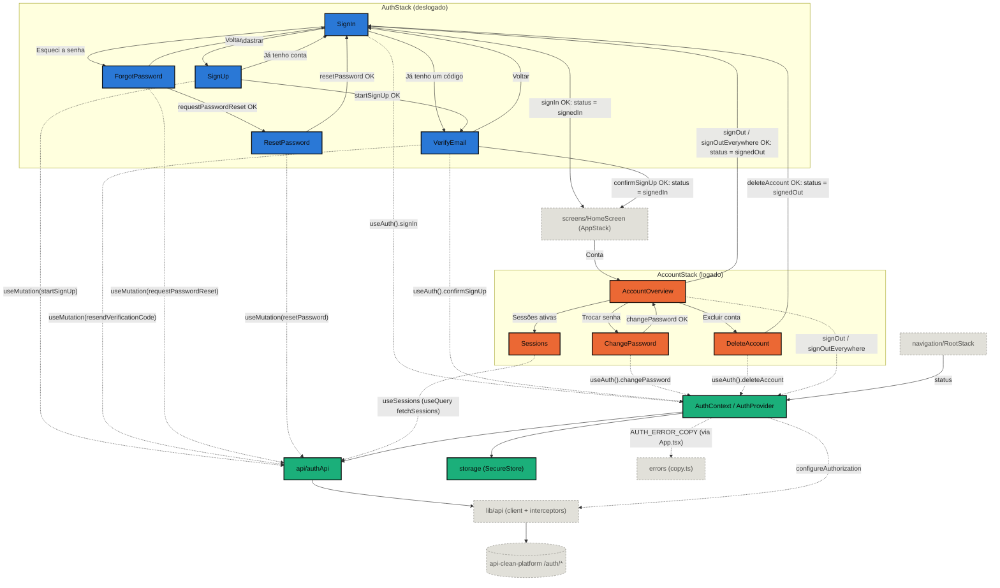

# Auth

Sessão do app: cadastro em três passos com verificação de e-mail, login,
recuperação e troca de senha, rotação do refresh token, restauração da sessão no
boot, logout (neste aparelho ou em todos), listagem das sessões ativas, exclusão
da conta e o estado que a navegação usa para escolher entre o stack logado e o
deslogado. Fala com treze dos catorze endpoints de `/auth` da API
(`api-clean-platform`): só `POST /auth/google` não tem caller, adiado até o
primeiro app se aproximar do release.

## Components

| Name        | Description                                                      |
| ----------- | ------------------------------------------------------------------ |
| `AuthProvider` | Guarda o token e o usuário. Registra-se no cliente HTTP na montagem. |
| `AuthStack` | Navigator do fluxo deslogado: `SignIn`, `SignUp`, `VerifyEmail`, `ForgotPassword` e `ResetPassword`. |
| `AccountStack` | Navigator da área logada: `AccountOverview`, `ChangePassword`, `Sessions` e `DeleteAccount`. O `AppStack` o registra como **uma** tela. |

## Hooks

| Name       | Description                                                              |
| ---------- | -------------------------------------------------------------------------- |
| `useAuth()` | `{ status, user, signIn, confirmSignUp, changePassword, deleteAccount, signOut, signOutEverywhere, isSubmitting, isSigningOut }`. Lança se usado fora do `AuthProvider`. |

## Constants

| Name            | Description                                                     |
| --------------- | ----------------------------------------------------------------- |
| `AUTH_STATUSES` | `loading` \| `signedOut` \| `signedIn`.                            |
| `AUTH_ERROR_COPY` | A copy dos códigos de erro de domínio deste módulo. O `App.tsx` a registra em `@/errors`. |

## Types

| Name                 | Description                                           |
| -------------------- | ------------------------------------------------------- |
| `AuthStatus`         | União derivada de `AUTH_STATUSES`.                      |
| `AuthContextValue`   | O que `useAuth()` devolve.                              |
| `User`               | Perfil de `/auth/me`. Datas são strings ISO.            |
| `Credentials`        | `{ email, password }`.                                  |
| `AuthStackParamList` | Parâmetros das rotas do fluxo deslogado. `SignIn` e `VerifyEmail` aceitam um `email` opcional; `ResetPassword` exige um. |
| `AccountStackParamList` | Parâmetros das rotas da área logada (`AccountOverview`, `ChangePassword`, `Sessions`, `DeleteAccount`). |

## Flow

Cada tela do fluxo deslogado (`AuthStack`) e da área logada (`AccountStack`)
aparece como nó próprio, com a navegação real entre elas — inclusive a que não
é um `navigate`: abrir ou encerrar a sessão troca o stack inteiro, porque o
`RootStack` renderiza um lado só. `SignIn`,
`VerifyEmail`, `ChangePassword`, `DeleteAccount` e `AccountOverview` passam pelo
`AuthProvider` via `useAuth()`; `SignUp`, `ForgotPassword` e `ResetPassword` não
escrevem nem leem sessão, então chamam a API direto pela própria `useMutation`,
e `Sessions` só lê, pela query de `useSessions`. Pra fora do módulo, o
diagrama cruza a fronteira em `lib/api` (onde o `AuthProvider` registra o
bearer token via `configureAuthorization`), `navigation/RootStack` (que lê
`status`) e `errors` (onde `App.tsx` registra `AUTH_ERROR_COPY`). Azul marca
as telas do `AuthStack`, laranja as do `AccountStack`, verde-água a infra que
o próprio módulo é dono (`Provider`, `authApi`, `storage`), e cinza tracejado
tudo que cruza a fronteira.

